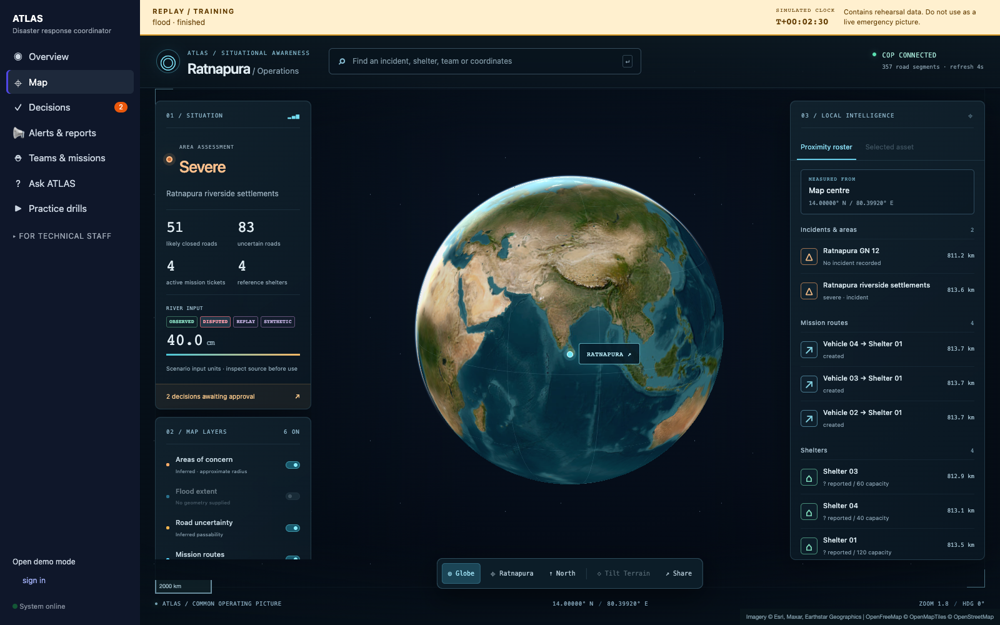
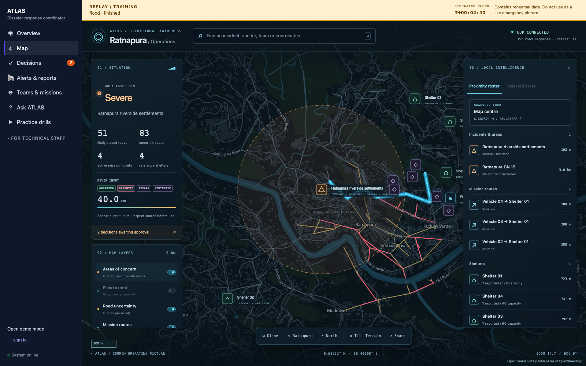
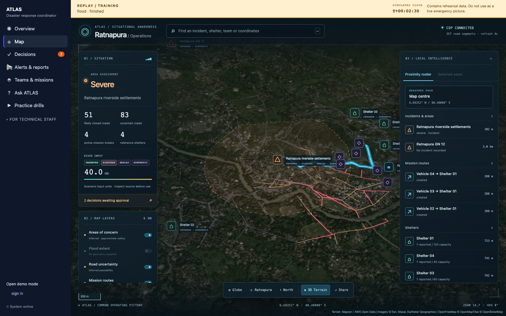
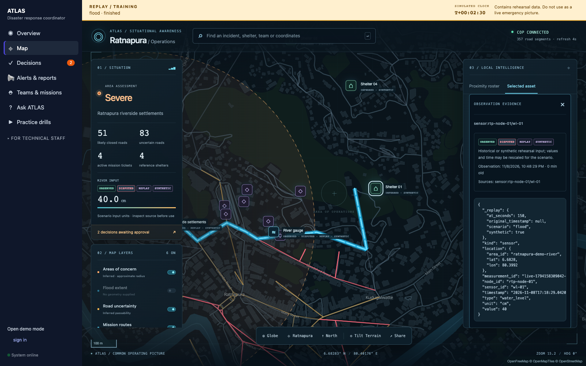
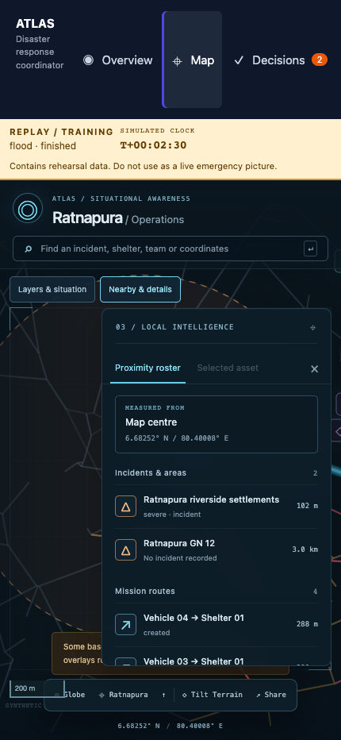

# U2 — situation map

Issue: [#10](https://github.com/Wicky2002/modelx-claptac/issues/10). Built on U1's provenance and replay context; review U1 first.

## Design reference

Read the actual [gods-eye-view source](https://github.com/bilawalsidhu/gods-eye-view/tree/52187c91d188504188ea9e9ae33e5b6e24cab7f2) before implementation: `IntelHudView.vue`, `UiPanel.vue`, `LayerPanelsView.vue`, `AwarenessPanel.vue`, `foundation.css`, and `cameraMotion.js`. For the globe revision, also inspected `src/app/viewer.js` and `src/app/globePanelRuntime.js`: its Cesium viewer uses a star backdrop, atmospheric rim, globe navigation, and cancellable camera movement. Adapted those ideas as original React/MapLibre code. No upstream source, assets, datasets, or models were copied. The reference source is MIT licensed; that license does not cover its third-party datasets/assets.

The revised plan was checked against the existing renderer and UI boundaries: restore `App.tsx` to U1, scope every custom style to the map, use MapLibre 5.24's native globe projection and atmosphere, retain the existing operational overlays, and verify shell isolation as well as globe → local map → evidence. This avoids a second renderer and keeps selection, polling, and provenance on one map. The original application sidebar, branding, sign-in controls, replay banner, and non-map pages are unchanged by U2.

The globe uses Esri world imagery, a subtle reference graticule, and an atmospheric rim. It is an interactive spherical map, with a Ratnapura entry point and a cancellable flight into the local operating area. The tactical basemap uses [OpenFreeMap](https://openfreemap.org/quick_start/) vector tiles with an original dark style and visible attribution. The local map uses tactical vectors, with imagery when tilted terrain is enabled; terrain is exaggerated 1.25× for legibility. Operational road geometry, routes and assets remain available when basemap requests fail. Imagery and terrain are background context, not live observations or flood measurements.

## Implemented

- Map-only dark command view with situation metrics, layer controls, camera dock, coordinate telemetry, and responsive panels. Map styles cannot restyle the surrounding console.
- A real 3D Earth view with drag/zoom navigation, atmosphere, imagery, and a geographic operating-area beacon. Detailed asset markers appear at local zoom to avoid overlapping at globe scale.
- Independent incident, flood-extent, road-uncertainty, route, shelter, fleet, and sensor layers.
- Keyboard-accessible proximity roster measured from a selection, clicked map point, or map centre; groups include roads, shelters, teams and gauges. Distances are straight-line, not travel estimates.
- Incident → mission route → destination shelter → source evidence, without navigating away. Selection remains current across polling; polling does not steal the camera.
- Globe / one-click Ratnapura zoom, north, tilted terrain, and shareable view coordinates (including world zoom); reduced-motion preference respected and transitions cancelled on a new selection.
- Readable evidence provenance and composable observed/inferred/disputed/stale/synthetic/replay labels inherited from U1.

## Data boundaries

No existing upstream feed supplies flood polygons. Inferred area radii are explicitly **not inundation boundaries**. `/dev/map` accepts valid GeoJSON Polygon/MultiPolygon values from COP beliefs with attribute `flood_extent`, carrying provenance and age into selectable map assessments. Invalid geometry is omitted. Without source geometry, the flood layer says “No geometry supplied” and is disabled.

Shelter capacity and fleet are synthetic reference data. Unknown occupancy stays unknown; expected arrivals are ticket totals, not confirmed movement. Shelter approach evidence concerns roads, not occupancy. Team markers are base locations, not tracking. These are data dependencies, not new integrations or U4 work.

## Verification and screenshots

Backend tests check route-to-incident/destination/evidence links and flood geometry validation. Browser tests use a real isolated FastAPI server and replay: compare the sidebar and replay-banner styles before/after entering the map, drag the globe, enter the local area, toggle layers and terrain, return to orbit, reload a shared globe view, follow the whole evidence workflow, block both basemap providers, verify narrow-screen navigation, and check browser exceptions. The frontend production build is committed.

```sh
source .venv/bin/activate
pytest -q
ruff check atlas tests
cd frontend
npm run build
npx playwright install chromium  # only if no local browser is available
npm run test:e2e
```

For screenshots, set `ATLAS_SCREENSHOT_DIR` and run `npm run test:e2e -- map.spec.ts`. `PLAYWRIGHT_CHROMIUM_EXECUTABLE` optionally selects an installed Chromium browser.






