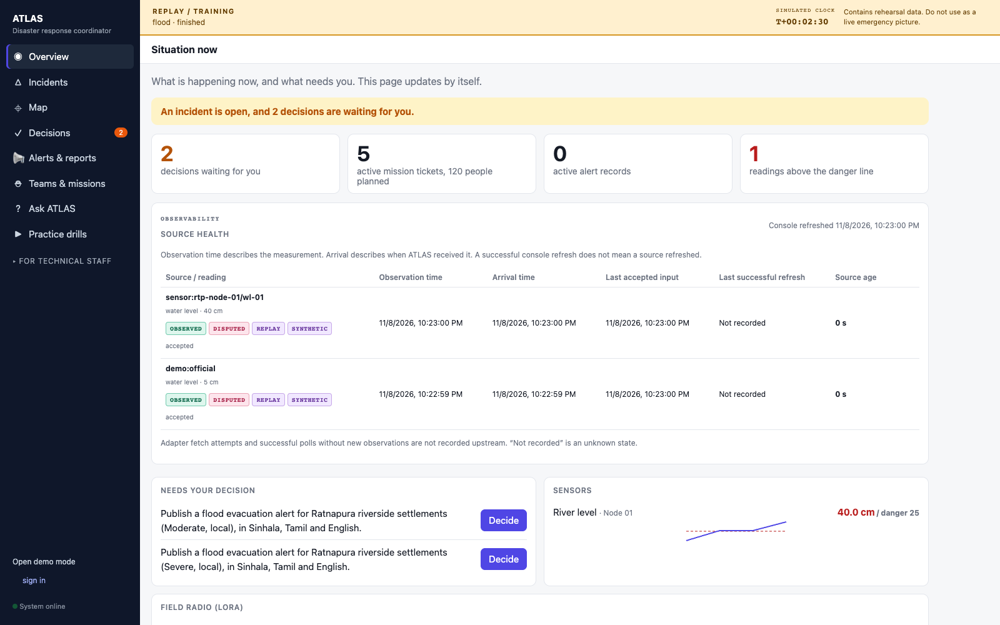
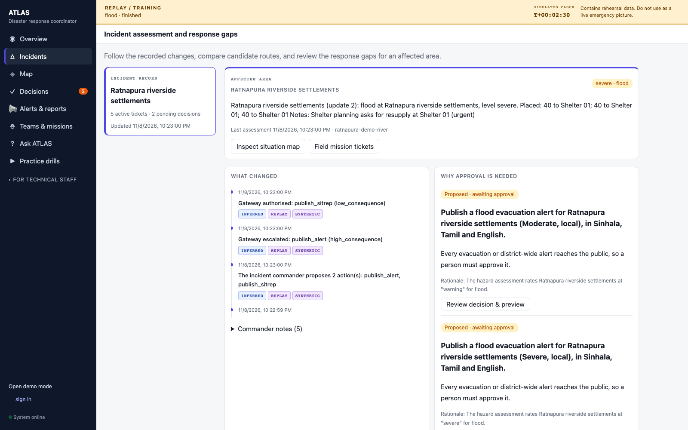
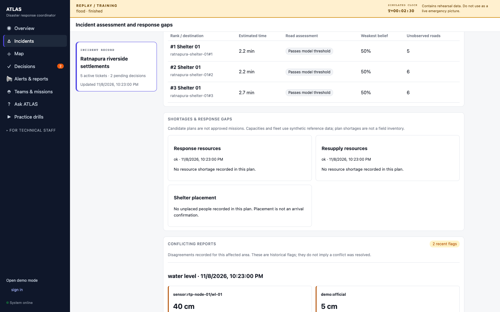
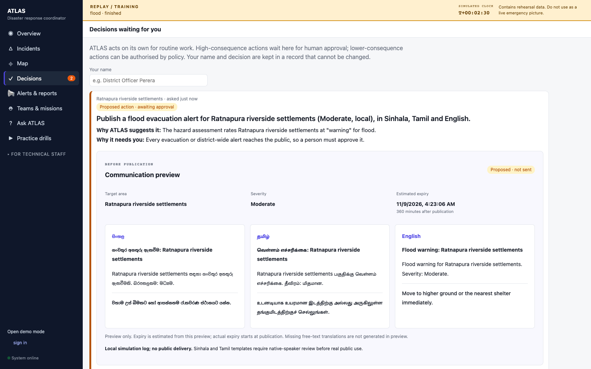
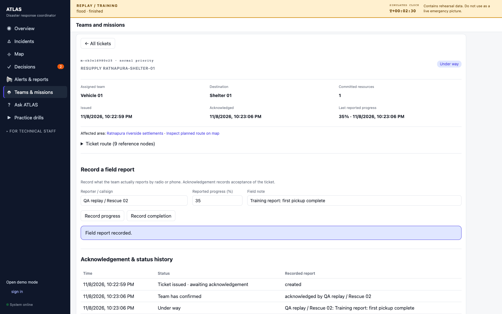
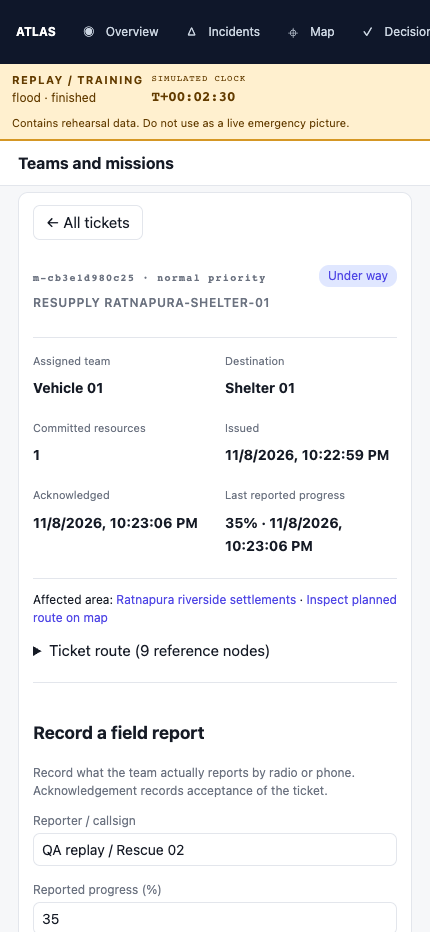

# U3 — console audit against §5.3 and §7.3

Issue [#11](https://github.com/Wicky2002/modelx-claptac/issues/11). This is the third PR in the U1 → U2 → U3 stack; U4's model-review integrations remain deferred.

## Acceptance checklist

| Requirement | Before | Result and remaining data limits |
|---|---|---|
| Source observation time | Recorded, not shown in operations | **Built:** Overview → Source health shows observation time and age for each sensor/feed stream. |
| Arrival time | Recorded in the event/validation ledger | **Built:** shown separately from observation time. |
| Last successful refresh | No adapter-fetch telemetry | **Built:** an explicit “Not recorded” column, plus last accepted input and console refresh shown separately. A feed-fetch timestamp cannot be reconstructed from an observation. This remains an upstream telemetry gap, never a fabricated success. |
| Source age and failed updates | Freshness existed inside Sentinel | **Built:** age/status badges, rejected-input reason, preserved last-good data and an error message when console polling fails. A rejected or duplicate input cannot advance last accepted input. |
| What changed and affected area | Ledger and commander state existed | **Built:** Incidents shows area, assessment cycle, recent changes, and commander notes. |
| Conflicting reports | Conflict events and evidence existed | **Built:** area-scoped conflict records with both sources, values, observation times, evidence IDs and provenance labels. Historical flags do not claim resolution. |
| Route alternatives | A4 already records ranked options | **Built:** destination, modelled travel time, road-threshold result, weakest belief, unobserved roads and plan timestamp. These are candidate plans, not field clearances. |
| Why approval is needed | Queue and policy reason existed | **Built:** incident-specific pending actions with plain-language reasons and rationale, linked to Decisions. |
| Communication preview | Texts existed only after publication | **Built:** target area, severity, estimated expiry and Sinhala/Tamil/English side by side before approval. The preview shares publication's renderer, performs no database writes, sends nothing and makes no model calls. Missing/excluded languages are explicit. |
| Shortages | A6/A7 already record shortfalls | **Built:** demanded/available resources, affected jobs, blocked routes and unplaced people with reasons. Empty or absent assessments are distinguished. Figures reflect synthetic reference fleet/capacities, not field inventory. |
| Field mission tickets | Tickets and updates already existed | **Built:** team filter, full ticket, destination/route/resources, issue/acknowledgement/update times, reporter callsign, explicit progress value and status history. Updates follow existing role and transition checks. |

The default alert transport is a local simulation log. A channel accepting a message does not establish recipient acknowledgement. Native-speaker review of the existing Sinhala/Tamil phrasebook is still required before actual public use. Preview expiry is calculated at preview time; publication calculates its own expiry.

## Implementation boundaries

- New read endpoints: `/dev/sources`, `/dev/operations/{incident_id}`, `/approvals/{approval_id}/preview`. They reuse existing read permissions. No new execution or ingest endpoint is introduced.
- Incident and source views project the existing ledger/COP/commander state. No agent contracts, planner decisions, approval rules, or source datasets change.
- Publication and preview share `_render_alert`; normal publication retains translation behaviour. Preview intentionally leaves unavailable free-text translations missing.
- Poll results belong to their URL. Late responses cannot replace a newly selected record; last-good data and its refresh time survive a failed poll. Scheduled requests do not overlap themselves.
- Development proxy now includes the existing `/links`, `/sitreps` and `/knowledge` endpoints used by the console.

## Verification

Backend tests cover distinct observation/arrival/accepted times, rejected and duplicate readings, invalid source timestamps, incident routes/shortages/conflicts, preview parity with publication templates, no preview writes/model calls, and viewer read/approval restrictions. Existing communications and control API tests remain covered.

The browser test uses a real isolated FastAPI instance and flood replay. It checks every source-health column and a failed poll, incident changes/alternatives/conflicts, all three preview languages without creating an alert, then records an acknowledgement and 35% progress report and verifies the actual mission history. Desktop and mobile screenshots are captured from that browser.

```sh
source .venv/bin/activate
ruff check atlas tests
pytest -q
cd frontend
npm run build
npm run test:e2e
```

Set `ATLAS_SCREENSHOT_DIR` and run `npm run test:e2e -- operations.spec.ts` to regenerate screenshots. `PLAYWRIGHT_CHROMIUM_EXECUTABLE` may point to an installed Chromium browser. Tests use a temporary database and disable MQTT and model calls.







